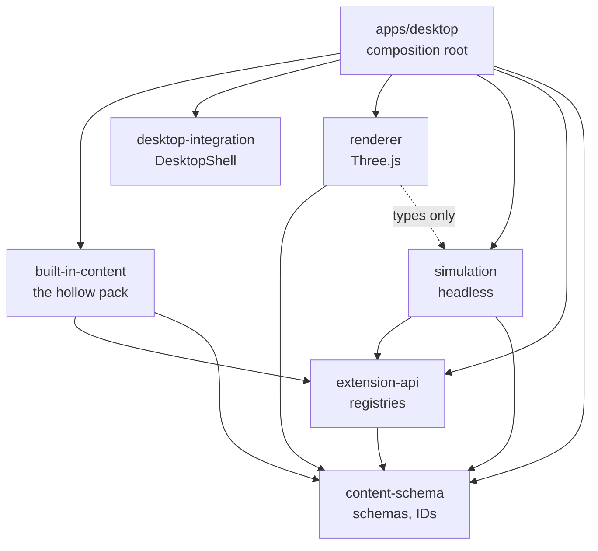
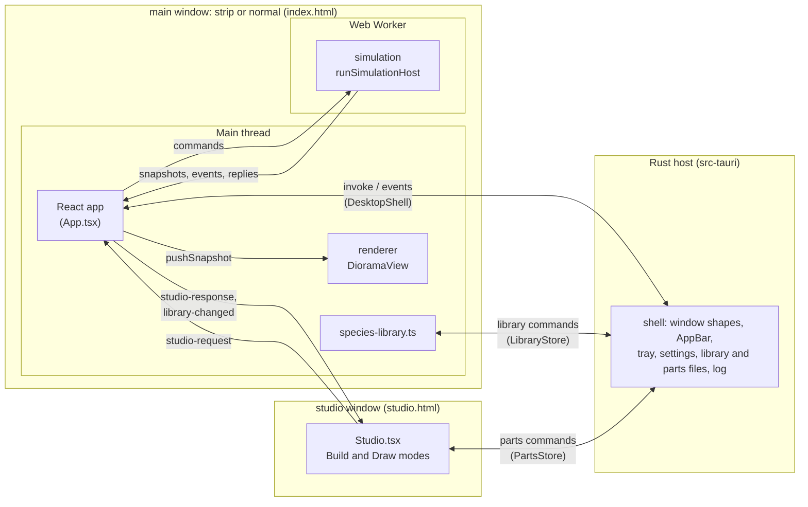

# Architecture

An overview of how Living Diorama is put together: the packages, what runs where, how the parts talk and which rules keep them apart. The reasons behind each choice are in the [ADRs](adr/); this page links to them rather than repeating them.

## Packages

The repo is a pnpm monorepo ([ADR 0001](adr/0001-monorepo-tooling.md)). Arrows point from a package to what it imports.

| Package               | Owns                                                                                                                                                                                                                                                                                                                                                                                                                                                                                                                                                               |
| --------------------- | ------------------------------------------------------------------------------------------------------------------------------------------------------------------------------------------------------------------------------------------------------------------------------------------------------------------------------------------------------------------------------------------------------------------------------------------------------------------------------------------------------------------------------------------------------------------ |
| `content-schema`      | The data contracts for worlds, structures and species, their schema versions, ID formats and validation with readable diagnostics ([ADR 0002](adr/0002-content-schema.md)). Also the species library entry schema and its migrations ([ADR 0014](adr/0014-species-library.md) §5–6), the voxel part and assembly formats with their edits and the seeded assembler ([ADR 0022](adr/0022-voxel-creatures.md), [ADR 0023](adr/0023-creature-assembly-studio.md)), and the drawing voxelizer and the player part entry ([ADR 0025](adr/0025-drawing-voxel-parts.md)). |
| `extension-api`       | The registries, registration, reference resolution across entries and semver checks ([ADR 0003](adr/0003-content-versioning.md)), and `addEntries`, which adds a batch of entries to resolved registries all or nothing ([ADR 0012](adr/0012-runtime-species.md) §3).                                                                                                                                                                                                                                                                                              |
| `simulation`          | All authoritative world and creature state: surfaces, walkability, the region graph, navigation and size limits, actions, behaviors, needs, the tick loop and the worker protocol ([ADR 0005](adr/0005-world-content-and-walkability.md), [ADR 0006](adr/0006-simulation-runtime-and-navigation.md), [ADR 0013](adr/0013-size-limits.md), [ADR 0018](adr/0018-living-behavior.md)).                                                                                                                                                                                |
| `renderer`            | Everything drawn: terrain, water, structures, props, creatures, camera, debug overlays and render throttling ([ADR 0007](adr/0007-renderer.md)). Voxel creature bodies built from their appearance assembly ([ADR 0022](adr/0022-voxel-creatures.md)), and the Studio's assembly view.                                                                                                                                                                                                                                                                             |
| `desktop-integration` | The frontend's OS-neutral `DesktopShell` interface and its Tauri implementation ([ADR 0008](adr/0008-desktop-shell.md)), the `LibraryStore` over the species library's files, the `PartsStore` over the player's parts, and the window channel between the Studio and the strip ([ADR 0015](adr/0015-creation-studio.md) §5).                                                                                                                                                                                                                                      |
| `built-in-content`    | The `hollow` pack: the Woodland Hollow world, the wooden bridge, the mossling and their asset files.                                                                                                                                                                                                                                                                                                                                                                                                                                                               |
| `apps/desktop`        | The Tauri app: the Rust shell in `src-tauri/` and two React pages, the strip (`index.html`), which wires everything together, and the Creation Studio (`studio.html`).                                                                                                                                                                                                                                                                                                                                                                                             |
| `tools/development`   | The world generator, the headless runner, the soak runs and test fixtures. Nothing imports it.                                                                                                                                                                                                                                                                                                                                                                                                                                                                     |

Each package's README lists what it owns and what it must not do.

## Runtime topology

The installed app is one Windows process tree: the Rust host and the WebView2 processes it starts. It has at most two windows, each with its own page:

- `main`, the diorama, which is either the strip or the expanded normal window. Its page runs on two threads: the main thread and the simulation worker.
- `studio`, the Creation Studio, which exists only while it is open. Its page has no worker and no world of its own.

- **Rust host.** Owns the windows and everything OS-specific: placing the strip on the work area, reserving screen space as an AppBar, switching the `main` window between its two shapes, DPI and monitor changes, focus policy, the tray menu, always-on-top, the settings file, the species library's and the player's parts' files, the saved world and the diagnostics log. Windows calls sit behind a `Platform` trait. It owns the paused, expanded and full-screen state and tells the page when they change ([ADR 0008](adr/0008-desktop-shell.md), [ADR 0016](adr/0016-integration-and-v0.2-build.md) §1–8).
- **Main thread.** `App.tsx` is the composition root. At startup it starts the worker on the world in `startup.ts`, creates the `DioramaView` from what the worker's `ready` message describes, and passes each snapshot to the view. It never loads content itself ([ADR 0010](adr/0010-content-startup.md)). `species-library.ts` keeps the player's species, every one a voxel species: it checks the stored entries, registers them and adds, removes and deletes them. `studio-protocol.ts` answers the Studio's requests from the library and the latest snapshot. Every failure (invalid content, a worker error, a renderer that can't start) replaces the view with the error screen ([ADR 0009](adr/0009-integration-and-v1-build.md) §2).
- **Simulation worker.** The only place content is registered and checked: the packs at `init` (`content.ts`), the library's species while the world runs. Builds the world state and runs the fixed 10 Hz tick. The simulation never reads the wall clock or `Math.random`; time is fed in and randomness comes from a seeded RNG, so a seed reproduces a run ([ADR 0006](adr/0006-simulation-runtime-and-navigation.md)).
- **Renderer.** Draws at the display rate while hovered or while the camera moves, about 30 fps otherwise, and nothing while the window is hidden. Creatures are drawn one tick behind the newest snapshot and interpolated between snapshots ([ADR 0007](adr/0007-renderer.md)). The renderer follows the window's pixel density when it moves between monitors.
- **Studio page.** Build mode (the assembly view, the parts tray, the body plan step and the name), Draw mode (the part grid and its 3D preview, [ADR 0025](adr/0025-drawing-voxel-parts.md)), and My creatures & parts. It holds only the creature being built, the part being drawn and the latest library snapshot. It reads and writes the player's parts itself, through `PartsStore`, and asks the strip for everything else ([ADR 0015](adr/0015-creation-studio.md) §4).

### One window, two shapes

Expanding doesn't open a window: the `main` window changes its style and size ([ADR 0016](adr/0016-integration-and-v0.2-build.md) §1). So there is one page, one worker and one WebGL context for the diorama, and nothing is forwarded between windows.

| Shape  | Window                                                                                                   | Band                                         |
| ------ | -------------------------------------------------------------------------------------------------------- | -------------------------------------------- |
| Strip  | Borderless, non-focusable, no taskbar or Alt+Tab entry (`WS_EX_TOOLWINDOW`), on top if the setting is on | Reserved as an AppBar, if the setting is on. |
| Normal | Framed, resizable, movable, focusable, in the taskbar and Alt+Tab; can be maximized or full screen       | Given back.                                  |

- `shell.rs` makes the switch. It cloaks the window while it changes, then shows it fully drawn. `placement.rs` decides each placement as a pure, unit-tested function of the shape and what triggered it. In the normal shape it never reserves the band and never re-places the window on a display change, since both caused loops ([ADR 0016](adr/0016-integration-and-v0.2-build.md) §8).
- The strip's style subclass and its activation hand-back ([ADR 0015](adr/0015-creation-studio.md) §1) stand aside in the normal shape, so the normal window can stay active.
- Closing the normal window turns it back into the strip. Its geometry is saved in `settings.json` as the optional `expanded` field, and the app always starts as the strip ([ADR 0016](adr/0016-integration-and-v0.2-build.md) §5).
- The page keeps one camera per shape (`shape-cameras.ts`), and handles F11, Esc and Home only in the normal shape (`shortcuts.ts`).

### The Creation Studio

Rust creates the `studio` window on demand, from the overlay's pencil button (`open_studio`) or the tray, one at a time. Closing it destroys it and frees its WebGL context; the world doesn't notice ([ADR 0015](adr/0015-creation-studio.md) §1). Its capability file, `capabilities/studio.json`, grants only targeted events, closing itself and the log.

The Studio never creates a `DesktopShell` and never hears the shell's events. Rust sends those to `main` only, and accepts `quit_ready` only from `main` ([ADR 0015](adr/0015-creation-studio.md) §6). Quitting closes the Studio with the app, and a creature not released or a part not saved is lost.

### The species library

Rust stores, TypeScript checks ([ADR 0014](adr/0014-species-library.md)).

- **Rust** (`src-tauri/src/library.rs`) keeps one folder per species in `%APPDATA%\com.livingdiorama.desktop\library`, named by the species' UUID, holding only `entry.json`: the species with its assembly inline ([ADR 0025](adr/0025-drawing-voxel-parts.md) §11). A drawn species' entry from before M23 no longer loads and is skipped; its old `drawing.json` and `appearance.png` are left alone. It saves and deletes atomically through a `.tmp` folder, accepts only lowercase UUIDs as IDs, limits each file's size, and never interprets the contents. Development builds use `LIVING_DIORAMA_DEV_DATA_DIR` instead when it is set.
- **TypeScript** (`species-library.ts`) reads the entries through `LibraryStore`, migrates and validates them with `content-schema`, and checks that each holds the species its folder names. An entry that fails is skipped with a diagnostic, and its files are left alone.
- At launch, once the world is ready, the library registers every stored species, one at a time, and spawns none. A species the world rejects stays in the list as unavailable. Deleting a species takes its creatures out of the world and deletes its files; it stays registered, unreachable, until the next launch.

### The saved world

Rust stores, TypeScript checks, as for the library ([ADR 0019](adr/0019-world-saving.md)).

- **Rust** (`src-tauri/src/world.rs`) keeps the save as text in `world.json` in the data directory, with the save before it as `world.prev.json`. It writes atomically, checks only that the file is JSON, and falls back to the backup when `world.json` is missing, too large, not UTF-8 or not JSON. A file that is there but can't be read (another program holds it, say) is an error instead. `WorldStore` in `desktop-integration` reaches it, with an in-memory version for tests and the browser.
- **TypeScript** (`world-saving.ts`) restores the save once the library has registered its species, and saves every minute, after a creature is added or taken out, and on quit. Saves run one after another, so an older one never lands after a newer one. The worker parses and validates the text; a save it rejects starts the world fresh, without trying the backup. When loading fails, the world starts fresh and nothing is saved until the next launch, so a save that can't be read for now is never overwritten. With a creature-count override the world is neither loaded nor saved.

### The player's parts

Rust stores, TypeScript checks, as for the library ([ADR 0025](adr/0025-drawing-voxel-parts.md) §6). `src-tauri/src/parts.rs` keeps one `<uuid>.json` per part in `parts/` in the data directory (or `LIVING_DIORAMA_DEV_DATA_DIR` in development builds): the voxel part and the drawing it was made from. It saves through a `.tmp` file and a rename, replacing the part when it is edited, accepts only lowercase UUIDs as IDs, limits each file to 1 MiB and never interprets the contents. A file it can't read is skipped with a log line. `PartsStore` in `desktop-integration` reaches it, with an in-memory version for tests and the browser. Player parts never pass through the simulation worker.

### Startup

1. The Rust host starts the diagnostics log and writes the version, Windows build and monitors to it, restores the settings, creates the hidden window, places it as the strip and starts the tray.
2. The page loads, starts the worker and sends `init` with the world from `startup.ts`.
3. The worker registers the engine's entries, then the built-in pack, resolves references and runs the world checks. Any error comes back as `error` and reaches the error screen as "The world failed to load".
4. The worker answers `ready` with the scene data (`SceneData`), the navigation overlays and the assets and species the renderer needs. `createDioramaView()` builds the scene from it and starts loading the prop models, and the world is still empty. The app opens the species library and registers its species ([ADR 0014](adr/0014-species-library.md) §8), then loads the saved world and sends `restore` with it, the wall-clock time and the time of day. On `restored` the view forgets the empty world's snapshots and the report is logged; on `rejected`, or with nothing saved, the app sends one `spawn` per starting creature ([ADR 0019](adr/0019-world-saving.md) §3). It then saves the world and starts saving every minute. Development builds expose the library as `window.livingDiorama.library` and the saved world as `window.livingDiorama.world`. From then on the strip answers the Studio's requests.
5. The worker sends a snapshot every tick, and the view draws it.

### Shutdown

Tray → Quit asks the page to stop first: the app saves the world, sends `shutdown` to the worker and disposes the view, then the host releases the reserved screen space and exits. The host waits at most three seconds for the page. The Studio, if open, closes with the app.

## Messages

### Main thread ↔ worker

Defined in [`packages/simulation/src/protocol.ts`](../packages/simulation/src/protocol.ts). Every message is wrapped in an envelope with `PROTOCOL_VERSION`, which is 25; the worker rejects a command with another version, and the app treats a message with another version as fatal. Commands carry only IDs and settings, plus species registered while the app runs: the worker loads content by itself, and `ready` sends back what the main thread draws.

Request commands (`register_species`, `spawn`, `despawn`, `check_limits`, `check_assembly`, `save`, `restore`, `catch_up`, `edit`, `validate_edit`) can fail in normal use. They carry a request ID and get a reply with it. `SimulationClient` turns each into a promise of a `Result` ([ADR 0012](adr/0012-runtime-species.md) §1, §8): `save` resolves with the save's JSON text, `restore` with the restore report, `catch_up` with the catch-up report, `edit` with the edit result (or its rejection) and `validate_edit` with the dry run's check ([ADR 0021](adr/0021-live-prop-editing.md)).

The client sends `catch_up` itself when the running world lost wall-clock time, for example while the OS slept with the app open ([ADR 0019](adr/0019-world-saving.md), as built, issue #113). Lost time is the gap between two consecutive snapshots' `wallMs` stamps less the simulation time between them, at the speed; paused snapshots and the first one after them don't count, so a paused world is never caught up, and a speed change starts the measure afresh. A rejected `catch_up` is logged as a warning.

| Direction     | Message                        | Meaning                                                                                                                                                                                              |
| ------------- | ------------------------------ | ---------------------------------------------------------------------------------------------------------------------------------------------------------------------------------------------------- |
| main → worker | `init`                         | World ID, seed, tick rate, creature cap and the local time of day. Always first.                                                                                                                     |
|               | `register_species`             | Add a species and the URL and kind (`voxel`, the only kind) of its appearance, checked like pack content.                                                                                            |
|               | `spawn`, `despawn`             | Add a creature of a species, optionally at a named spawn point, or take one out. `released` marks a Studio release.                                                                                  |
|               | `check_limits`                 | Where creatures of a size class and capabilities wouldn't fit, without registering anything.                                                                                                         |
|               | `check_assembly`               | A voxel assembly being released: its structure, then its part and socket types against the registered ones. Checked and dropped, never kept ([ADR 0022](adr/0022-voxel-creatures.md)).               |
|               | `save`                         | Save the world between ticks, also while paused; `savedAt` is the wall-clock time.                                                                                                                   |
|               | `restore`                      | Replace the world with a save, as JSON text parsed and checked by the worker, given the wall-clock time and time of day ([ADR 0019](adr/0019-world-saving.md) §3, §7).                               |
|               | `catch_up`                     | Catch the running world up for wall-clock time it lost, given the gap and the time of day, as a restore after the same gap would.                                                                    |
|               | `edit`, `validate_edit`        | Apply a world edit between ticks, or check one without applying it ([ADR 0021](adr/0021-live-prop-editing.md) §1, §10).                                                                              |
|               | `pause`, `resume`, `set_speed` | Control the clock.                                                                                                                                                                                   |
|               | `set_time_of_day`              | The local time of day, every minute and on resume ([ADR 0018](adr/0018-living-behavior.md) §5).                                                                                                      |
|               | `set_debug`                    | Include each walking creature's remaining route, need values, knowledge and home in snapshots.                                                                                                       |
|               | `shutdown`                     | Stop the clock and close the worker.                                                                                                                                                                 |
| worker → main | `ready`                        | The world loaded: scene data, navigation overlays, assets and species to draw, the prop types and categories for the editor, and the voxel part types with their roles, motions and drawing recipes. |
|               | `snapshot`                     | Every tick: the time of day, creature positions, headings and cues, plus the events since the previous snapshot and the worker's wall-clock time (`wallMs`).                                         |
|               | `species_registered`           | A species was registered: its summary, its appearance asset and its limits.                                                                                                                          |
|               | `limits`                       | The answer to `check_limits`: the profile's limits, or the errors that keep it out of the world, and the locomotion rules of the capabilities asked about.                                           |
|               | `assembly_checked`             | The answer to `check_assembly`: what is wrong with the assembly, empty when nothing is.                                                                                                              |
|               | `spawned`, `despawned`         | A request succeeded, with the creature's ID.                                                                                                                                                         |
|               | `saved`                        | The answer to `save`: the save as JSON text, ready to store.                                                                                                                                         |
|               | `restored`                     | The answer to `restore`: the gap since the save and what was dropped or pruned. The next snapshot shows the restored world.                                                                          |
|               | `caught_up`                    | The answer to `catch_up`: whether catch-up ran, over how long a gap, and which behaviors' catch-up failed.                                                                                           |
|               | `edited`, `edit_checked`       | The answer to `edit` (the edit as applied, its inverse, footprints, warnings, moved creatures) or to `validate_edit`.                                                                                |
|               | `world_changed`                | The world's content changed, after an edit or a restore of an edited world: new scene data and navigation overlays.                                                                                  |
|               | `rejected`                     | A request failed, with diagnostics (for example `world_full`). Not fatal: the world keeps running. A rejected `restore` leaves the world unchanged: start fresh.                                     |
|               | `error`                        | A command was misused, with diagnostics. The app treats it as fatal.                                                                                                                                 |

Creature positions are region-relative (`regionId`, `x`, `z`); the snapshot also carries the resolved world position, so the renderer needs no surface lookups. See [world coordinates](world-coordinates.md).

Each creature's `cues` say what it visibly shows, so the renderer needs no action or need IDs: its action's cue (`eating`, `sleeping`) while that action isn't walking, then each need's cue from the value the need declares (`hungry`) ([ADR 0018](adr/0018-living-behavior.md) §15).

Each creature's `animation` names the animation profile of the capability it moves by where it is (`walk` or `hop` on land, the species' gait; `swim` in water), and `submersion` how far its body sits below the surface (0 on land), so the renderer never reads capability IDs or region kinds ([ADR 0020](adr/0020-body-plans-swimming-and-live-edits.md) §8–§9). An `entered_region` after a jump across a bank, between land and water, has no `connectionId`.

Creature events are `creature_spawned`, `species_introduced`, `creature_despawned`, `entered_region`, `first_use_of_structure`, `path_failed`, `creature_stuck`, `ate` (a finished meal, with the placement and the hunger after it), `fell_asleep` (beside a shelter, or where it stood), `woke_up` (`rested` or `interrupted`) and `new_home_selected`; each carries a `creatureId`. Actions emit theirs through `ActionContext.emit`; the engine emits `new_home_selected` when an action calls `ActionContext.setHome`. `species_introduced` follows the first creature of a species in the world; registering alone doesn't introduce one.

World events carry no `creatureId`. So far there is only `day_phase_changed`, with the phase before and after (dawn, day, dusk or night). It is not sent for the time the world starts at, and a jump across several phases sends one.

### Studio ↔ strip

The window channel in [`packages/desktop-integration/src/channel.ts`](../packages/desktop-integration/src/channel.ts) carries typed requests over targeted Tauri events. [`apps/desktop/src/studio-protocol.ts`](../apps/desktop/src/studio-protocol.ts) defines what they hold and how the strip answers ([ADR 0015](adr/0015-creation-studio.md) §5, §12).

- The Studio sends `studio-request` to `main` with `{ requestId, request }`. `main` answers with `studio-response` to `studio`, carrying `{ requestId, result }` or `{ requestId, error }`. A request with no answer in 5 seconds fails with a timeout.
- `main` pushes `library-changed` with a library snapshot whenever the library changes, or the count of a species in the world does.
- Each side listens with its own window label as the target, so it never hears events sent to the other window.

| Request          | What the strip does                                                                                                                       |
| ---------------- | ----------------------------------------------------------------------------------------------------------------------------------------- |
| `snapshot`       | Returns the library now: each species with its library UUID and count in the world, the world's total and its cap.                        |
| `limits`         | Runs `check_limits` for a size class and ways of moving; the confirm step's preview moves by the rules that come back.                    |
| `parts`          | Returns the registered voxel parts, part types (with their roles, motions and drawing recipes) and socket types, from the latest `ready`. |
| `assembly`       | Returns a library species' assembly, for its picture in My creatures or to edit a copy.                                                   |
| `releaseVoxel`   | Saves an assembly as a species (`SpeciesLibrary.saveVoxel`) and adds one creature. Repeating a `releaseId` gets the first answer.         |
| `addCreature`    | Adds a creature of a library species, unless the world is full.                                                                           |
| `removeCreature` | Takes the newest creature of a species out of the world.                                                                                  |
| `deleteSpecies`  | Deletes a species from the library; its creatures leave the world.                                                                        |

Pictures don't travel in snapshots. The Studio draws them itself with the renderer's `VoxelThumbnails`: a species' from its `assembly`, a part's from the `parts` answer or, for the player's own parts, from `PartsStore`. The player's parts never travel over the channel.

### Page ↔ Rust host

Defined by `DesktopShell`, `LibraryStore`, `PartsStore` and `WorldStore` in [`packages/desktop-integration/src`](../packages/desktop-integration/src/) and the commands registered in `apps/desktop/src-tauri/src/lib.rs`.

- Commands from the strip: set the strip height, pause, expand or collapse, enter or leave full screen, hide, open the Studio, confirm it is ready to quit, and record event counts.
- Library commands: list, save and delete entries ([ADR 0014](adr/0014-species-library.md)). Parts commands, from the Studio: list, save and delete the player's parts ([ADR 0025](adr/0025-drawing-voxel-parts.md) §6). World commands: load and save the world ([ADR 0019](adr/0019-world-saving.md)).
- Events from the host, sent to `main` only: paused changed, expanded changed, full screen changed, quit requested.
- Log lines from either page: `desktop-integration` forwards every `console.warn` and `console.error` through `tauri-plugin-log`, and the app logs each failure the error screen shows. The host writes them, with its own lines, to `%LOCALAPPDATA%\com.livingdiorama.desktop\logs`; the tray's **Open log folder** opens it ([ADR 0009](adr/0009-integration-and-v1-build.md) §13–15).

The tray and the page's controls both go through the host, so the host's state is the only one and both views of it stay in sync.

## Content

Content is data registered into typed registries, and the engine refers to it only by ID. The flow is the same for built-in and third-party content:

1. `createRegistries()` makes empty registries: `worlds`, `structures`, `props`, `species`, `surfaces`, `actions`, `behaviors`, `capabilities`, `affordances`, `assets`, `needs`, `senses`, `traits`.
2. `registerCoreEngine()` adds the engine's own entries under the `core` namespace: the surface types, the locomotion capabilities `core:land` and `core:swim`, the affordances, needs, senses and traits, the actions (`core:idle`, `core:follow_path`, `core:eat`, `core:sleep`) and the behaviors (`core:wander`, `core:feed`, `core:rest`).
3. Each pack registers its entries. Registration validates each entry against its schema and rejects duplicates.
4. `resolveReferences()` checks every reference between entries: the target exists, its version satisfies the declared range, and target-specific checks pass (surface params against the surface type's schema, a prop's model is a model asset).
5. `checkWorld()` builds the world model and runs the semantic checks for each navigation profile (size class plus capabilities).

[Adding content](adding-content.md) walks through writing a pack.

### Species added while the world runs

The player's species, from the library, go through the same schemas, registries and checks as pack content, and no engine code tells them apart ([ADR 0012](adr/0012-runtime-species.md)).

1. `register_species` builds an asset of the kind it is sent (`voxel`, a voxel assembly: the only kind since drawn bodies went, [ADR 0025](adr/0025-drawing-voxel-parts.md) §11) whose ID is the species' `appearance`, whose version is the species' version and whose URL it is sent. The worker keeps only the URL and kind, never the file ([ADR 0022](adr/0022-voxel-creatures.md) §20).
2. `addEntries()` validates the species and its asset, resolves their references against what is registered, and registers both only if everything passes.
3. If the species brings a new navigation profile, `checkNavigation()` builds that profile's navigation and runs the per-profile world checks. Errors reject the species; the profile is kept only if registration succeeds.
4. The world holds at most `maxCreatures` creatures (20, from `startup.ts`). A spawn beyond that is rejected with `world_full`.

The `user:` namespace for the player's species, and `user-part:` for the player's parts, are the app's conventions (`user-species.ts`, `content-schema`'s `playerPartId`). The engine doesn't reserve them.

### Size limits

A creature only goes where it fits ([ADR 0013](adr/0013-size-limits.md)). For each profile, a region's walkable cells split into connected areas, and wander only picks cells reachable from where the creature stands.

- **Limits are warnings**: a region split into areas (`disconnected_region`), a portal with no room (`portal_unusable`, naming the structure), a spawn point with no room (`spawn_not_walkable`), a region with nowhere to stand (`no_walkable_area`), water an amphibious creature can get into but not climb out of (`no_water_exit`). Cut-off slivers up to 1 m² don't count.
- **Broken geometry stays an error**: a portal whose surfaces don't meet, two regions walkable at the same place and height (`ambiguous_overlap`), or no usable spawn point at all (`no_spawn_point`).

This holds for pack species at startup too. Each profile's limits come back with `species_registered` and `limits` as `Limit`s, diagnostics that name the structure they are about, and the Studio turns them into the player's words. In the Woodland Hollow, large creatures can't cross the wooden bridge; the other sizes go everywhere.

## Voxel creatures

Every creature is built from voxel parts ([ADR 0022](adr/0022-voxel-creatures.md)). A **voxel part** (`voxel.ts` in `content-schema`) is at most 32 cubes along each axis at one step of the ladder (1.25, 2.5, 5 or 10 cm), with a palette, an attach point, sockets for other parts and a part type. An **assembly** (`voxel-assembly.ts`) is a creature: copies of the parts it uses and the instances that place them, each on a socket of its parent with a rotation and an optional mirror. Part and socket types (fits, roles such as `root` and `tail`, motions, drawing recipes) are pack content the worker registers; the strip learns the registered parts from `ready` and hands them to the Studio with the `parts` request.

### How a species gets its body

1. **Assembly.** A pack ships its species' assemblies as `voxel` assets (the mossling's frozen `assets/voxels/mossling.json`). The player's come from the Studio's Build mode, whose edits (`voxel-edit.ts`) only ever return valid assemblies, or from the seeded assembler `assembleParts` (Randomize, Fill empty and the development hooks). Each assembly holds frozen copies of its parts, so editing or deleting a part later never changes a released creature (ADR 0022 §17).
2. **Species.** Releasing sends the assembly to the strip (`releaseVoxel`). `SpeciesLibrary.saveVoxel` measures it (`measureAssembly`: size class, ground contact, center of gravity and tail, all from the cubes), has the worker check its part and socket types (`check_assembly`), and saves the species with the assembly inline. The species' `appearance` is a `voxel` asset; registering it sends the worker a `blob:` URL of the assembly's JSON, and the worker keeps only the URL and kind.
3. **Body.** The renderer (`creatures.ts`) shows a fallback block the size of the species' size class, reads the assembly from the asset's URL and checks it. `buildVoxelBody` (`voxel/body.ts`) meshes every part's cubes (`voxel/mesher.ts`) into one geometry per species with one bone per instance, so a creature is one skinned mesh. `buildMotionRig` (`voxel/motion-rig.ts`) gives each bone its part type's motion, scaled by the part's size, on one rhythm per creature ([ADR 0024](adr/0024-per-part-animation.md)). The Studio's assembly view and the part and species pictures (`VoxelThumbnails`) use the same body code.

### How a drawn part becomes a voxel part

1. **Draw mode** (`studio/PartDrawMode.tsx`, [ADR 0025](adr/0025-drawing-voxel-parts.md)). The player draws on a 32 × 32 grid, one cell a cube, for a part type and against a base part of that type. The part type's drawing recipe (`partDrawingRecipeLookup`) gives the starting view (side, front or top) and depth rule (puffy, tube or flat). Undo keeps snapshots of the grid (`grid-editor.ts`).
2. **Voxelizer.** `voxelizeDrawing` (`voxel-draw.ts` in `content-schema`, pure) maps the canvas to the part's axes by the view (`VIEW_AXES`), gives each cell its depth by the rule (from a distance transform for puffy and tube) and crops to the drawn cells.
3. **Fit.** `fitDrawnPart` scales the base part's attach point and sockets to the drawing and snaps each to the depth its base socket has (the validator's `isBuried`), reporting each socket's depth and flagging the shallow ones. Points the player drags are kept in canvas terms (`drawn-points.ts`) and override the fit's.
4. **Parts store.** Save makes a player part entry (`draw-entry.ts`: ID `user-part:<uuid>`, version, the voxel part and the drawing it came from, checked against its schema) and writes it through `PartsStore` to `parts/<uuid>.json` (see "The player's parts"). An edit saves in place with the version raised.
5. **Build tray.** `player-parts.ts` reads and checks the entries, and `withPlayerParts` adds them to Build mode's kit after the pack parts of their type. Picking one puts a frozen copy in the assembly, and from there it is an ordinary part (above). Player parts are never registered with the worker: the world checks an assembly's fits by part and socket type only.

## Boundary rules

Checked in CI by `pnpm boundaries` (dependency-cruiser, [`.dependency-cruiser.cjs`](../.dependency-cruiser.cjs)) and `pnpm lint`:

- `simulation` is headless: no `three`, `react`, `@tauri-apps/*`, Node built-ins or DOM APIs, so it runs unchanged in Node tests and in the worker.
- `renderer` imports only types from `simulation` and never changes simulation state.
- Only `desktop-integration` imports `@tauri-apps/api`.
- No package imports `built-in-content`; only the app and the dev tools do, and it registers like any other pack.
- Packages never import apps or tools, and workspace packages import each other only through their `index.ts`.
- Engine code must not branch on content IDs (`id === "core:bridge"`); it uses capabilities and affordances instead (an ESLint rule).
- No circular imports and no undeclared dependencies.
