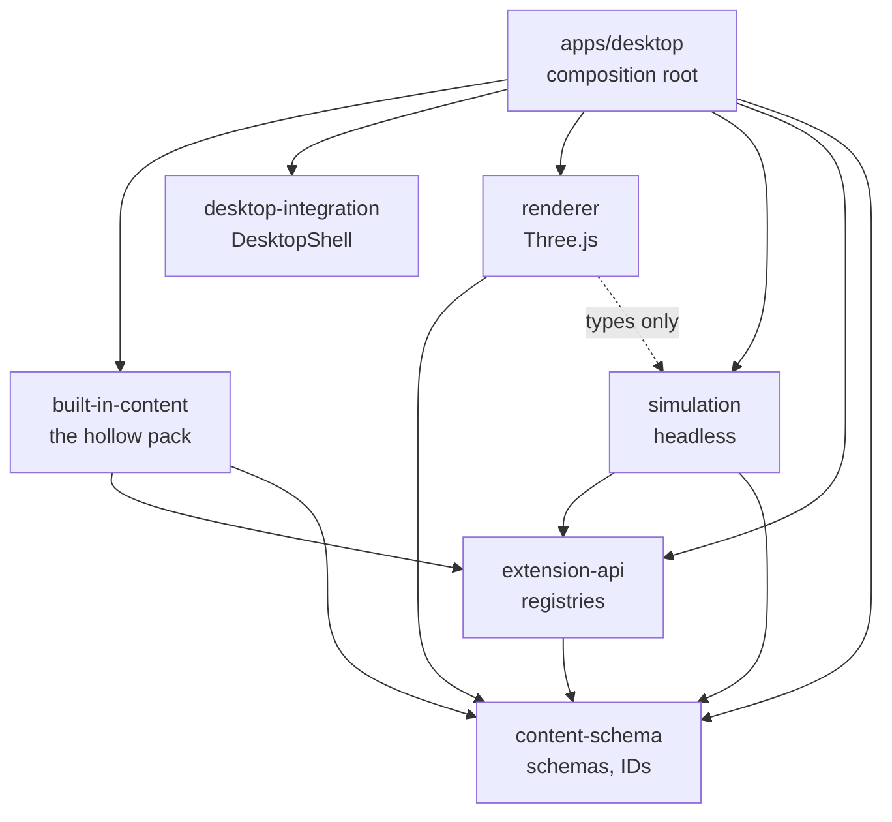
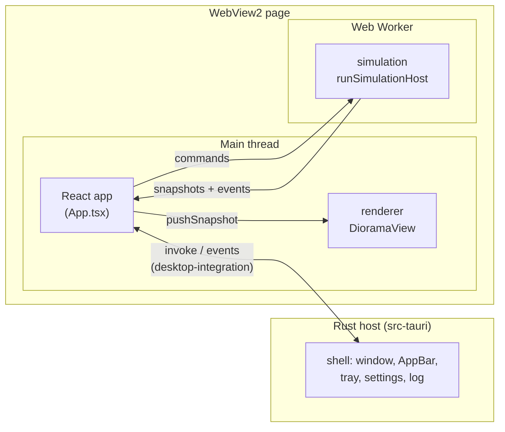

# Architecture

An overview of how Living Diorama is put together: the packages, what runs where, how the parts talk and which rules keep them apart. The reasons behind each choice are in the [ADRs](adr/); this page links to them rather than repeating them.

## Packages

The repo is a pnpm monorepo ([ADR 0001](adr/0001-monorepo-tooling.md)). Arrows point from a package to what it imports.

| Package               | Owns                                                                                                                                                                                                                                                                           |
| --------------------- | ------------------------------------------------------------------------------------------------------------------------------------------------------------------------------------------------------------------------------------------------------------------------------ |
| `content-schema`      | The data contracts for worlds, structures and species, their schema versions, ID formats and validation with readable diagnostics ([ADR 0002](adr/0002-content-schema.md)).                                                                                                    |
| `extension-api`       | The registries, registration, reference resolution across entries and semver checks ([ADR 0003](adr/0003-content-versioning.md)).                                                                                                                                              |
| `simulation`          | All authoritative world and creature state: surfaces, walkability, the region graph, navigation, actions, behaviors, the tick loop and the worker protocol ([ADR 0005](adr/0005-world-content-and-walkability.md), [ADR 0006](adr/0006-simulation-runtime-and-navigation.md)). |
| `renderer`            | Everything drawn: terrain, water, structures, props, creatures, camera, debug overlays and render throttling ([ADR 0007](adr/0007-renderer.md)).                                                                                                                               |
| `desktop-integration` | The frontend's OS-neutral `DesktopShell` interface and its Tauri implementation ([ADR 0008](adr/0008-desktop-shell.md)).                                                                                                                                                       |
| `built-in-content`    | The `hollow` pack: the Woodland Hollow world, the wooden bridge, the mossling and their asset files.                                                                                                                                                                           |
| `apps/desktop`        | The Tauri app: the Rust shell in `src-tauri/` and the React host that wires everything together.                                                                                                                                                                               |
| `tools/development`   | The world generator, the headless runner, the soak runs and test fixtures. Nothing imports it.                                                                                                                                                                                 |

Each package's README lists what it owns and what it must not do.

## Runtime topology

The installed app is one Windows process tree: the Rust host and the WebView2 processes it starts. The page in the WebView runs on two threads.

- **Rust host.** Owns the window and everything OS-specific: placing the strip on the work area, reserving screen space as an AppBar, DPI and monitor changes, focus policy, the tray menu, always-on-top, expanded mode, the settings file, the species library's files and the diagnostics log. Windows calls sit behind a `Platform` trait. It owns the paused and expanded state and tells the page when they change ([ADR 0008](adr/0008-desktop-shell.md)).
- **Main thread.** `App.tsx` is the composition root. At startup it starts the worker on the world in `startup.ts`, creates the `DioramaView` from what the worker's `ready` message describes, and passes each snapshot to the view. It never loads content itself ([ADR 0010](adr/0010-content-startup.md)). `species-library.ts` keeps the drawn species: it checks the stored entries, registers them and adds, removes and deletes them. Every failure (invalid content, a worker error, a renderer that can't start) replaces the view with the error screen ([ADR 0009](adr/0009-integration-and-v1-build.md) §2).
- **Simulation worker.** The only place content is registered and checked (`content.ts`). Builds the world state and runs the fixed 10 Hz tick. The simulation never reads the wall clock or `Math.random`; time is fed in and randomness comes from a seeded RNG, so a seed reproduces a run ([ADR 0006](adr/0006-simulation-runtime-and-navigation.md)).
- **Renderer.** Draws at the display rate while hovered or while the camera moves, about 30 fps otherwise, and nothing while the window is hidden. Creatures are drawn one tick behind the newest snapshot and interpolated between snapshots ([ADR 0007](adr/0007-renderer.md)).

### Startup

1. The Rust host starts the diagnostics log and writes the version, Windows build and monitors to it, restores the settings, creates the hidden window, places it and starts the tray.
2. The page loads, starts the worker and sends `init` with the world from `startup.ts`.
3. The worker registers the engine's entries, then the built-in pack, resolves references and runs the world checks. Any error comes back as `error` and reaches the error screen as "The world failed to load".
4. The worker answers `ready` with the scene data (`SceneData`), the navigation overlays and the assets and species the renderer needs. `createDioramaView()` builds the scene from it and starts loading the prop models, and the app sends one `spawn` per starting creature. The app then opens the species library and registers its species one at a time, spawning none ([ADR 0014](adr/0014-species-library.md)); development builds expose it as `window.livingDiorama.library`.
5. The worker sends a snapshot every tick, and the view draws it.

### Shutdown

Tray → Quit asks the page to stop first: the app sends `shutdown` to the worker and disposes the view, then the host releases the reserved screen space and exits. The host waits at most one second for the page.

## Messages

### Main thread ↔ worker

Defined in [`packages/simulation/src/protocol.ts`](../packages/simulation/src/protocol.ts). Every message is wrapped in an envelope with `PROTOCOL_VERSION`; the worker rejects a command with another version, and the app treats a message with another version as fatal. Commands carry only IDs and settings, plus species registered while the app runs: the worker loads content by itself, and `ready` sends back what the main thread draws. Request commands (`register_species`, `spawn`, `despawn`) can fail in normal use; they carry a request ID and get a reply with it ([ADR 0012](adr/0012-runtime-species.md)).

| Direction     | Message                        | Meaning                                                                                   |
| ------------- | ------------------------------ | ----------------------------------------------------------------------------------------- |
| main → worker | `init`                         | World ID, seed, tick rate and creature cap. Always first.                                 |
|               | `register_species`             | Add a species and its appearance image, checked like pack content.                        |
|               | `spawn`, `despawn`             | Add a creature of a species, optionally at a named spawn point, or take one out.          |
|               | `pause`, `resume`, `set_speed` | Control the clock.                                                                        |
|               | `set_debug`                    | Include each walking creature's remaining route in snapshots.                             |
|               | `shutdown`                     | Stop the clock and close the worker.                                                      |
| worker → main | `ready`                        | The world loaded: scene data, navigation overlays, and assets and species to draw.        |
|               | `snapshot`                     | Every tick: creature positions and headings, plus the events since the previous snapshot. |
|               | `species_registered`           | A species was registered: its summary, its appearance asset and where it doesn't fit.     |
|               | `spawned`, `despawned`         | A request succeeded, with the creature's ID.                                              |
|               | `rejected`                     | A request failed, with diagnostics. Not fatal: the world keeps running.                   |
|               | `error`                        | A command was misused, with diagnostics. The app treats it as fatal.                      |

Creature positions are region-relative (`regionId`, `x`, `z`); the snapshot also carries the resolved world position, so the renderer needs no surface lookups. See [world coordinates](world-coordinates.md).

Events are `creature_spawned`, `species_introduced`, `creature_despawned`, `entered_region`, `first_use_of_structure`, `path_failed` and `creature_stuck`.

### Page ↔ Rust host

Defined by `DesktopShell` in [`packages/desktop-integration/src/shell.ts`](../packages/desktop-integration/src/shell.ts) and the commands registered in `apps/desktop/src-tauri/src/lib.rs`.

- Commands from the page: set the strip height, pause, expand, hide, confirm it is ready to quit, and record event counts; list, load, save and delete species library entries ([ADR 0014](adr/0014-species-library.md)).
- Events from the host: paused changed, expanded changed, quit requested.
- Log lines from the page: `desktop-integration` forwards every `console.warn` and `console.error` through `tauri-plugin-log`, and the app logs each failure the error screen shows. The host writes them, with its own lines, to `%LOCALAPPDATA%\com.livingdiorama.desktop\logs`; the tray's **Open log folder** opens it ([ADR 0009](adr/0009-integration-and-v1-build.md) §13–15).

The tray and the page's controls both go through the host, so the host's state is the only one and both views of it stay in sync.

## Content

Content is data registered into typed registries, and the engine refers to it only by ID. The flow is the same for built-in and third-party content:

1. `createRegistries()` makes empty registries: `worlds`, `structures`, `species`, `surfaces`, `actions`, `behaviors`, `capabilities`, `affordances`, `assets`.
2. `registerCoreEngine()` adds the engine's own entries under the `core` namespace: the surface types, `core:walk`, `core:crossable`, the actions and the `core:wander` behavior.
3. Each pack registers its entries. Registration validates each entry against its schema and rejects duplicates.
4. `resolveReferences()` checks every reference between entries: the target exists, its version satisfies the declared range, and target-specific checks pass (surface params against the surface type's schema, a prop's model is a model asset).
5. `checkWorld()` builds the world model and runs the semantic checks for each navigation profile: every region has walkable area in one piece, every portal and spawn point is usable, and no two regions are walkable at the same place and height.

[Adding content](adding-content.md) walks through writing a pack.

## Boundary rules

Checked in CI by `pnpm boundaries` (dependency-cruiser, [`.dependency-cruiser.cjs`](../.dependency-cruiser.cjs)) and `pnpm lint`:

- `simulation` is headless: no `three`, `react`, `@tauri-apps/*`, Node built-ins or DOM APIs, so it runs unchanged in Node tests and in the worker.
- `renderer` imports only types from `simulation` and never changes simulation state.
- Only `desktop-integration` imports `@tauri-apps/api`.
- No package imports `built-in-content`; only the app and the dev tools do, and it registers like any other pack.
- Packages never import apps or tools, and workspace packages import each other only through their `index.ts`.
- Engine code must not branch on content IDs (`id === "core:bridge"`); it uses capabilities and affordances instead (an ESLint rule).
- No circular imports and no undeclared dependencies.
